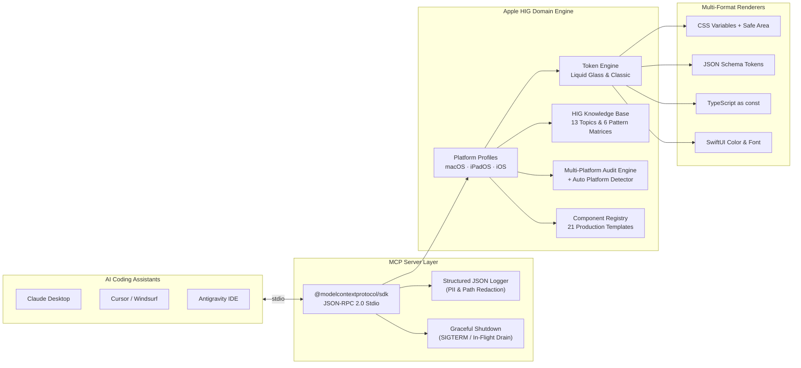

<div align="center">

# 🍎 Apple Style MCP Server (`@ahmad/apple-style-mcp`)

**Enterprise-Grade Model Context Protocol (MCP) Server untuk Audit Arsitektur, Design Tokens, dan Scaffolding Komponen Produksi Berbasis Apple Human Interface Guidelines (HIG) Lintas macOS, iPadOS, dan iOS**

[](https://github.com/ahmadeko2017/apple-style-mcp/actions/workflows/ci.yml)
[](https://github.com/ahmadeko2017/apple-style-mcp/blob/main/CHANGELOG.md)
[](https://modelcontextprotocol.io)
[](https://www.typescriptlang.org/)
[](#%EF%B8%8F-testing--quality-gates)
[](https://github.com/ahmadeko2017/apple-style-mcp/blob/main/LICENSE)

</div>

---

## 🌟 Mengapa Proyek Ini Dibuat?

Membangun aplikasi lintas perangkat Apple (**macOS Desktop**, **iPadOS Tablet**, dan **iOS Mobile**) menggunakan teknologi modern (**Tauri v2**, **React + TypeScript**, maupun **SwiftUI**) sering kali mengalami inkonsistensi ergonomi dan visual:

- Ikon sidebar yang bergeser (_layout shift_) saat diciutkan di macOS.
- Bayangan (_box-shadow_) menu yang terpotong bingkai jendela frameless `12px` atau memicu garis hitam `1px` pada Windows DWM.
- Penggunaan material **Liquid Glass** (iOS 26 / iPadOS 26 / macOS Tahoe) yang keliru diterapkan pada layer konten.
- Ukuran target sentuh di bawah `44x44pt` atau ketiadaan `viewport-fit=cover` & `env(safe-area-inset-*)` di sekitar _Dynamic Island_ dan _Home Indicator_.

**`@ahmad/apple-style-mcp`** hadir sebagai **Single Source of Truth** bagi AI Coding Agents (Claude Desktop, Cursor, Windsurf, Antigravity) untuk secara otomatis mengaudit proyek, mengekstrak _design tokens_ multi-format, membandingkan pola UI lintas perangkat, dan men-scaffold **21 komponen siap produksi**.

---

## 🏛️ Arsitektur Sistem



---

## 📊 Matriks Ergonomi & Geometri Multi-Platform Apple HIG

| Dimensi Desain                     | 🖥️ macOS (`macos`)                                                                         | 📱 iPadOS (`ipados`)                                                         | 📱 iOS (`ios`)                                                                          |
| :--------------------------------- | :----------------------------------------------------------------------------------------- | :--------------------------------------------------------------------------- | :-------------------------------------------------------------------------------------- |
| **Referensi OS**                   | macOS 26 Tahoe / Sonoma                                                                    | iPadOS 26                                                                    | iOS 26                                                                                  |
| **Paradigma Navigasi**             | Zero-Shift Collapsible Sidebar (`63px`/`220px`) + Titlebar `38px` + Command Palette (`⌘K`) | Adaptive Split View (2/3 Kolom, Sidebar `320px`) ⇄ Morphing Floating Tab Bar | Liquid Glass Floating Tab Bar (`49px`, auto-minimize saat scroll) + Large Title Nav Bar |
| **Modalitas Input**                | Pointer presisi + Keyboard + Trackpad                                                      | Multi-Touch + Apple Pencil + Trackpad Pointer (Magnetic Hover) + Keyboard    | Multi-Touch + Haptic Touch                                                              |
| **Target Sentuh Minimum**          | `28 × 28 pt`                                                                               | `44 × 44 pt`                                                                 | `44 × 44 pt`                                                                            |
| **Ukuran Font Body / Large Title** | `13 pt` / `26 pt`                                                                          | `17 pt` / `34 pt` (Dynamic Type)                                             | `17 pt` / `34 pt` (Dynamic Type, Input `>= 16px`)                                       |
| **Window Chrome & Safe Area**      | Frameless Window (`12px` radius) + Traffic Lights (`#ff5f56`, `#ffbd2e`, `#27c93f`)        | Stage Manager Resizable Window + Safe Area Insets                            | Edge-to-Edge (`viewport-fit=cover`) + Dynamic Island & Home Indicator Safe Area         |
| **Aturan Material Liquid Glass**   | Sidebar, Titlebar, Command Palette, Toast                                                  | Split View Sidebar, Floating Tab Bar, Popover                                | Floating Tab Bar, Navigation Bar, Bottom Sheet                                          |

---

## 🚀 Quick Start

### Prasyarat

- **Node.js** `>= 22.12.0` (direkomendasikan Node.js 24 LTS)
- **npm** `>= 10.0.0`

### Instalasi & Build

```bash
# 1. Clone repositori
git clone https://github.com/ahmadeko2017/apple-style-mcp.git
cd apple-style-mcp

# 2. Instal seluruh dependensi
npm install

# 3. Build ke direktori dist/
npm run build
```

### Integrasi dengan AI Client (`mcp_config.json` / `claude_desktop_config.json`)

```json
{
  "mcpServers": {
    "apple-style-mcp": {
      "command": "node",
      "args": ["/absolute/path/to/apple-style-mcp/dist/index.js"]
    }
  }
}
```

---

## 🛠️ Dokumentasi Tools MCP (6 Primary Tools + 3 Legacy Aliases)

### 1. `audit_apple_project` _(Alias v1: `audit_desktop_project`)_

Mengaudit direktori proyek secara statis dan non-destruktif terhadap standar Apple HIG lintas `macos`, `ipados`, dan `ios` (mendukung deteksi platform otomatis).

**Parameter Input:**

| Nama           | Tipe                                  | Wajib | Deskripsi                                                                  |
| :------------- | :------------------------------------ | :---: | :------------------------------------------------------------------------- |
| `project_path` | `string`                              | Tidak | Path direktori proyek yang diaudit (default: direktori aktif)              |
| `platforms`    | `Array<"macos" \| "ipados" \| "ios">` | Tidak | Target platform yang diaudit (jika kosong, otomatis dideteksi dari proyek) |

**Contoh Output:**

```json
{
  "projectPath": "/workspace/my-apple-app",
  "targetPlatforms": ["macos", "ipados", "ios"],
  "complianceScore": "100%",
  "platformScores": {
    "macos": "100%",
    "ipados": "100%",
    "ios": "100%"
  },
  "totalChecks": 14,
  "passedChecks": 14,
  "failedChecks": 0
}
```

---

### 2. `scaffold_apple_component` _(Alias v1: `scaffold_macos_component`)_

Menghasilkan kode komponen **React + TypeScript** produksi siap pakai (21 komponen tersedia):

| Kategori               | Nama Komponen (`component`) | Deskripsi                                                                                              |
| :--------------------- | :-------------------------- | :----------------------------------------------------------------------------------------------------- |
| **macOS Desktop**      | `mac_traffic_lights`        | Tombol kontrol jendela merah/kuning/hijau dengan simbol mikro SVG saat hover                           |
|                        | `adaptive_titlebar`         | Titlebar `38px` dengan IPC drag region Tauri, pencarian `⌘K`, dan tombol tema `26px`                   |
|                        | `zero_shift_sidebar`        | Collapsible sidebar (`63px`/`220px`) dengan koordinat X ikon terkunci di `21px`                        |
|                        | `command_palette`           | Modal Spotlight `⌘K` Liquid Glass dengan navigasi penuh `ArrowUp`/`ArrowDown`/`Enter`/`Esc`            |
|                        | `toast_banner`              | Banner notifikasi kanan atas bergaya macOS dengan aturan Zero-Shadow                                   |
|                        | `inspector_panel`           | Panel detail slide-out kanan dengan scroll terisolasi                                                  |
|                        | `context_menu_guard`        | Utilitas penonaktifan klik kanan browser bawaan pada elemen non-input                                  |
|                        | `shortcut_formatter`        | Pemformat token `Mod+K` menjadi `⌘K` (macOS/iPadOS/iOS) atau `Ctrl + K` (Windows/Linux)                |
| **iPadOS Tablet**      | `ipad_split_view`           | Tata letak Split View 2/3 kolom (`320px` sidebar) dengan dukungan toggle                               |
|                        | `adaptive_sidebar_tabbar`   | Navigasi yang otomatis bertransformasi dari Sidebar (`>=768px`) menjadi Floating Tab Bar (`<768px`)    |
|                        | `ipad_popover`              | Popover kontekstual Liquid Glass bebas bayangan luar                                                   |
|                        | `pointer_hover_effect`      | Tombol dengan efek magnetik kursor trackpad iPadOS (`translate3d`)                                     |
| **iOS Mobile**         | `ios_tab_bar`               | Floating Capsule Tab Bar iOS 26 yang menyusut otomatis saat scroll ke bawah                            |
|                        | `ios_navigation_bar`        | Navigation Bar dengan _Large Title_ (`34px`) yang menyusut ke tengah (`17px`) saat scroll              |
|                        | `ios_bottom_sheet`          | Modal Bottom Sheet dengan detents `medium` (`52dvh`) & `large` (`92dvh`) + grabber handle              |
|                        | `ios_inset_grouped_list`    | Daftar bergaya _Inset Grouped_ iOS dengan radius `16px` dan tinggi baris minimum `44px`                |
|                        | `ios_segmented_control`     | Segmented control berlapis dengan indikator tab aktif                                                  |
| **Universal / Shared** | `adaptive_app_shell`        | Shell aplikasi universal yang merender navigasi sesuai proporsi macOS, iPadOS, atau iOS                |
|                        | `platform_detector`         | Detektor `macos` / `ipados` (termasuk deteksi `Macintosh` + `maxTouchPoints > 1`) / `ios` & Size Class |
|                        | `safe_area_provider`        | Pembungkus root dengan tinggi `100dvh` dan variabel `env(safe-area-inset-*)`                           |
|                        | `liquid_glass_surface`      | Kontainer permukaan Liquid Glass khusus layer navigasi dengan _specular highlight border_              |

---

### 3. `get_design_tokens`

Mengekstrak design tokens resmi dalam 4 format output:

- `format`: `"css"` | `"json"` | `"typescript"` | `"swift"` (ekstensi SwiftUI `Color`, `Font`, & `Layout`)
- `platform`: `"macos"` | `"ipados"` | `"ios"`
- `design_era`: `"liquid_glass"` (default) | `"classic"`
- `palette_mode`: `"apple_system"` (default) | `"brand_custom"`
- `accent_primary`: Kode warna hex kustom (misal `"#0284c7"`)

---

### 4. `scaffold_apple_app_template` _(Alias v1: `scaffold_base_app_template`)_

Menghasilkan konfigurasi awal proyek (`src-tauri/tauri.conf.json`, `src/styles/tokens.css`, serta `index.html` dengan `viewport-fit=cover` apabila menyertakan target `ios`/`ipados`). Dilengkapi pengaman `dry_run: true` dan `overwrite: false`.

---

### 5. `get_apple_hig_rule`

Lookup penjelasan teknis dan formula matematika untuk **13 topik Apple HIG**:
`zero_shift_geometry`, `zero_shadow_popovers`, `window_frame_canvas`, `titlebar_controls`, `spotlight_command_palette`, `toast_banner`, `liquid_glass_materials`, `touch_and_hit_targets`, `safe_area_and_viewport`, `ipad_split_view_and_morphing`, `ipad_pointer_and_stage_manager`, `ios_floating_tab_bar`, `ios_large_title_and_sheets`.

---

### 6. `compare_platform_pattern`

Menghasilkan matriks JSON perbandingan implementasi pola UI antara macOS, iPadOS, dan iOS untuk topik:
`navigation`, `modality`, `context_actions`, `notifications`, `window_and_safe_area`, dan `typography_and_ergonomics`.

---

## 📚 Daftar MCP Resources

| URI Resource                     | MIME Type          | Deskripsi                                                          |
| :------------------------------- | :----------------- | :----------------------------------------------------------------- |
| `apple://hig/overview`           | `application/json` | Profil ergonomi lengkap macOS, iPadOS, dan iOS                     |
| `apple://hig/liquid-glass`       | `text/markdown`    | Panduan hierarki material Liquid Glass (OS 26 / macOS Tahoe)       |
| `apple://hig/ipados`             | `text/markdown`    | Kumpulan pedoman Split View, Morphing Tab Bar, dan Trackpad iPadOS |
| `apple://hig/ios`                | `text/markdown`    | Kumpulan pedoman Floating Tab Bar, Large Title, dan Safe Area iOS  |
| `desktop://guidelines/macos-hig` | `text/markdown`    | Pedoman arsitektur desktop macOS (kompatibilitas v1)               |
| `desktop://geometry/zero-shift`  | `text/plain`       | Formula matematika koordinat `21px` Zero-Shift Sidebar             |

---

## 📂 Struktur Direktori Proyek

```text
apple-style-mcp/
├── src/
│   ├── index.ts                        # CLI entry point (stdio server)
│   ├── server.ts                       # MCP SDK Server & JSON-RPC 2.0 dispatcher
│   ├── registry.ts                     # ToolRegistry & ResourceRegistry
│   ├── types.ts                        # Kontrak tipe protokol MCP
│   ├── core/
│   │   ├── errors.ts                   # Hirarki custom domain error classes
│   │   ├── fs/safe-fs.ts               # Pemindai direktori aman & path guard
│   │   └── platform/                   # Spesifikasi profil macOS, iPadOS, & iOS
│   ├── server/
│   │   ├── logger.ts                   # Structured JSON logger + PII & path redaction
│   │   └── shutdown.ts                 # Graceful shutdown (SIGTERM / request draining)
│   ├── tokens/
│   │   ├── token-definitions.ts        # Single source of truth design tokens
│   │   └── renderers.ts                # Renderer CSS, JSON, TypeScript, & SwiftUI
│   ├── knowledge/
│   │   ├── hig-topics.ts               # Basis pengetahuan 13 topik Apple HIG
│   │   └── pattern-comparisons.ts      # Matriks komparasi 6 pola UI lintas platform
│   ├── audit/
│   │   ├── detector.ts                 # Detektor otomatis platform proyek target
│   │   └── audit-engine.ts             # Mesin evaluasi kepatuhan multi-platform
│   ├── components/                     # 21 template komponen produksi (macOS/iPadOS/iOS/Shared)
│   ├── tools/                          # Implementasi McpTool handlers
│   ├── resources/                      # Implementasi McpResource providers
│   └── __tests__/
│       └── server.test.ts              # Suite pengujian unit & integrasi (Pola AAA)
├── .github/
│   ├── workflows/ci.yml                # GitHub Actions CI Quality Gate
│   ├── ISSUE_TEMPLATE/                 # Template Bug Report & Feature Request
│   └── PULL_REQUEST_TEMPLATE.md        # Template checklist Pull Request
├── CHANGELOG.md                        # Catatan rilis SemVer
├── CONTRIBUTING.md                     # Panduan kontribusi & standar Clean Code
├── SECURITY.md                         # Kebijakan keamanan & fitur proteksi bawaan
└── LICENSE                             # Lisensi MIT
```

---

## 🧪 Testing & Quality Gates

Proyek ini dilengkapi pipeline verifikasi kualitas terpadu (`npm run verify`) yang mencakup pemeriksaan tipe statis, linting tanpa `any`, pemformatan kode, pengujian unit/integrasi dengan ambang batas coverage ketat, dan kompilasi produksi:

```bash
# Menjalankan seluruh gate verifikasi sekaligus
npm run verify

# Atau menjalankan masing-masing perintah:
npm run typecheck      # tsc --noEmit (strict mode)
npm run lint           # ESLint flat config (0 warnings, 0 explicit any)
npm run format:check   # Prettier code style verification
npm run test:coverage  # Vitest + v8 coverage (>92% line coverage)
npm run build          # Build ESM + TypeScript declarations ke dist/
```

---

## 🤝 Kontribusi & Keamanan

- Silakan baca [CONTRIBUTING.md](./CONTRIBUTING.md) untuk standar penulisan kode (Clean Code, SOLID, batas 30 baris/fungsi, dan pola pengujian AAA).
- Untuk kebijakan keamanan dan pelaporan kerentanan, lihat [SECURITY.md](./SECURITY.md).

---

## 📜 Lisensi

Didistribusikan di bawah **MIT License**. Lihat file [LICENSE](./LICENSE) untuk informasi selengkapnya.

Dikembangkan oleh **Ahmad Eko Kurniawan**.
